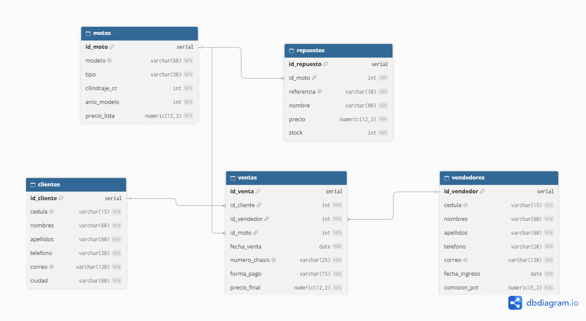
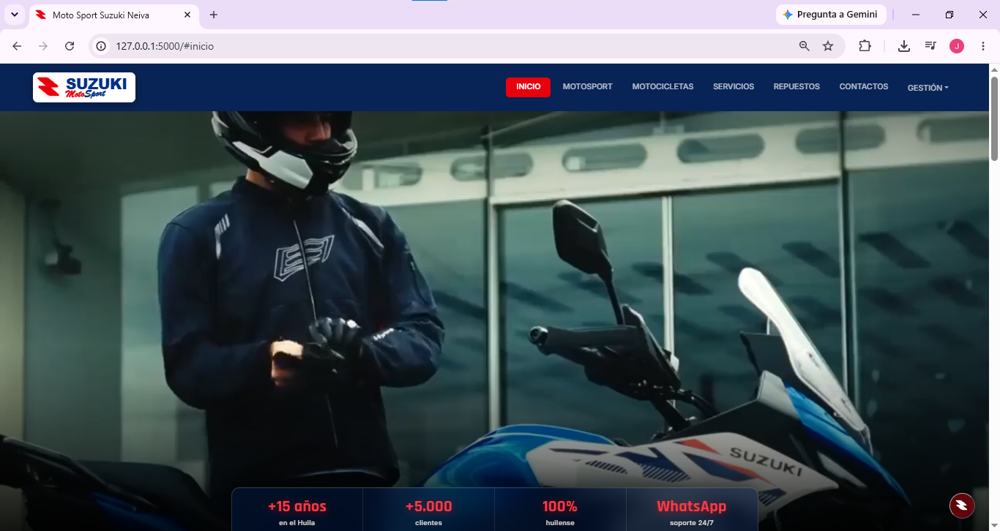
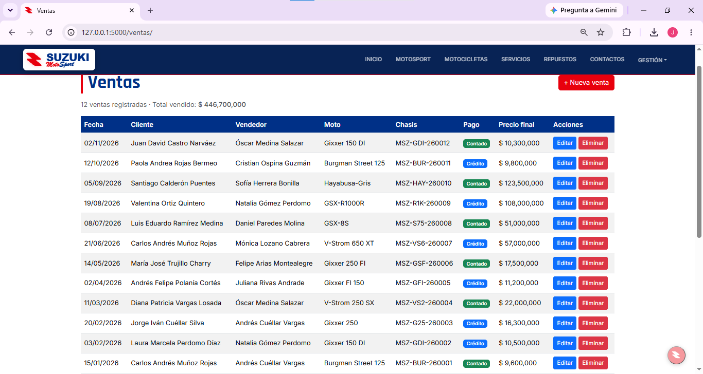
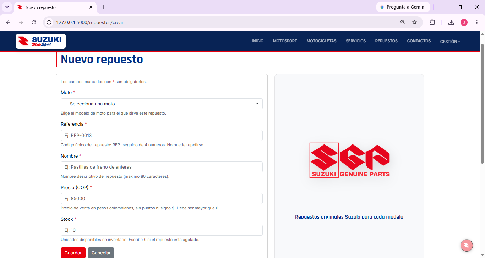

# Concesionaria de Motos – Proyecto Final Programación Web

Aplicación web CRUD desarrollada con **Flask** y **PostgreSQL** para gestionar una concesionaria de motocicletas inspirada en **Moto Sport Suzuki (Huila)**. Permite administrar el catálogo de motos, los repuestos de cada modelo, los clientes, los vendedores y las ventas realizadas.

Proyecto final del curso de Programación Web – Universidad Surcolombiana.

## Integrantes

- Juan Sebastian Trujillo Muñoz
- Andrés Camilo Vanegas Caviedes

## Tecnologías

| Tecnología | Uso |
| --- | --- |
| Python 3.13 | Lenguaje del backend |
| Flask 3.1 | Framework web (rutas, Blueprints y plantillas) |
| PostgreSQL | Base de datos relacional |
| psycopg2 | Conexión entre Python y PostgreSQL |
| Jinja2 | Plantillas HTML con herencia |
| Bootstrap 5 | Interfaz (tablas, formularios, alertas y menú) |
| Git y GitHub | Control de versiones |

## Funcionalidades

- CRUD completo (listar, crear, editar y eliminar) de las 5 tablas: motos, repuestos, clientes, vendedores y ventas.
- Los listados muestran los nombres de los datos relacionados, no solo sus ID.
- Las llaves foráneas se seleccionan con listas desplegables.
- Validación de los formularios en el servidor, con mensajes claros al usuario.
- Manejo de errores de la base de datos: valores duplicados e intentos de eliminar registros relacionados no hacen fallar la aplicación.
- Consultas SQL parametrizadas.
- Eliminación con ventana de confirmación previa.
- Página de inicio con el diseño de Moto Sport Suzuki: video, catálogo de motos, servicios y sedes.

## Modelo Entidad-Relación

La base de datos tiene 5 tablas normalizadas hasta la Tercera Forma Normal (3FN). La tabla `ventas` es la tabla de transacciones y tiene tres llaves foráneas (cliente, vendedor y moto).



| Relación | Cardinalidad |
| --- | --- |
| motos – repuestos | 1 : N |
| motos – ventas | 1 : N |
| clientes – ventas | 1 : N |
| vendedores – ventas | 1 : N |

El diccionario de datos y la justificación de la normalización están en [`docs/diccionario_datos.pdf`](docs/diccionario_datos.pdf).

## Instalación y ejecución

### Requisitos previos

- Python 3.10 o superior
- PostgreSQL y pgAdmin4
- Git

### 1. Clonar el repositorio

```bash
git clone https://github.com/sebas12yxz-blip/proyecto_final_PW.git
cd proyecto_final_PW
```

### 2. Crear el entorno virtual e instalar las dependencias

```bash
python -m venv .venv
.venv\Scripts\activate
pip install -r requirements.txt
```

En PowerShell, si la activación da un error de ejecución de scripts, usar `.venv\Scripts\activate.bat` o ejecutar antes `Set-ExecutionPolicy -Scope CurrentUser RemoteSigned`.

### 3. Crear y cargar la base de datos

Crear en PostgreSQL una base de datos llamada `concesionaria_motos` y cargarla con una de estas dos opciones:

- **Opción A (cualquier versión de PostgreSQL):** en el Query Tool de pgAdmin4, ejecutar en orden:
  1. `database/01_crear_tablas.sql`
  2. `database/02_cargar_datos.sql`
- **Opción B (backup completo):** desde la terminal, o desde la PSQL Tool de pgAdmin4:

  ```bash
  psql -U postgres -d concesionaria_motos -f database/backup.sql
  ```

  El backup se generó con PostgreSQL 18; con versiones anteriores de `psql` se recomienda la opción A.

### 4. Configurar las credenciales

Copiar el archivo `.env.example`, renombrar la copia como `.env` y escribir la contraseña de PostgreSQL:

```
DB_HOST=localhost
DB_PORT=5432
DB_NAME=concesionaria_motos
DB_USER=postgres
DB_PASSWORD=tu_contraseña
SECRET_KEY=una_clave_secreta
```

El archivo `.env` no se sube al repositorio.

### 5. Ejecutar la aplicación

```bash
python app.py
```

Abrir en el navegador: http://127.0.0.1:5000

## Estructura del proyecto

```
proyecto_final_PW/
├── app.py              # Punto de entrada de Flask y registro de Blueprints
├── config.py           # Lectura de la configuración desde .env
├── db.py               # Conexión a PostgreSQL
├── routes/             # Un Blueprint por tabla (CRUD)
├── templates/          # Plantillas Jinja2 (base.html + una carpeta por tabla)
├── static/             # CSS, JavaScript, imágenes y videos
├── database/           # Scripts SQL y backup.sql
├── docs/               # MER, diccionario de datos, plan de pruebas y capturas
├── tests/              # Pruebas automatizadas
├── requirements.txt
├── .env.example
├── .gitignore
└── README.md
```

## Pruebas

El plan de pruebas funcionales tiene 20 casos (4 por tabla) con sus evidencias. Cubre la creación, el listado, la edición y la eliminación de registros, los datos inválidos, los valores duplicados y los intentos de eliminar registros relacionados.

Documento: [`docs/plan_de_pruebas_funcionales.pdf`](docs/plan_de_pruebas_funcionales.pdf)

## Capturas de la aplicación

### Página de inicio


### Listado de ventas


### Formulario de repuestos


## Créditos

El diseño visual se basa en el rediseño de la página de Moto Sport Suzuki hecho por Daniel Bahamon y colaboradores. Los datos de clientes y vendedores son ficticios; los precios de las motos son aproximados.
